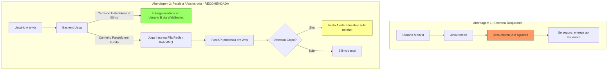

# ⚡ Arquitetura de Inferência em Tempo Real no Chat (Anjo da Guarda)

Este documento detalha como a Inteligência Artificial do **BeyondTime** atua no chat em tempo real sem causar atrasos de envio para os usuários e sem sobrecarregar o servidor.

---

## 🧭 1. Princípio Fundamental: Chat Sem Atrasos (< 50ms)

> [!IMPORTANT] Regra de Ouro da Experiência do Usuário (UX 50+)
> Em nenhuma hipótese o envio ou recebimento de mensagens terá atrasos perceptíveis (como 5 ou 10 segundos). A troca de mensagens entre os usuários é **instantânea**, ocorrendo através de WebSockets em menos de 50 milissegundos.

---

## 🏎️ 2. A Velocidade Real do Modelo (Scikit-Learn vs. LLMs)

Um dos maiores equívocos em projetos de IA modernos é comparar modelos clássicos de Machine Learning com LLMs (ChatGPT, Claude, Gemini):

| Característica | LLMs Generativas (Ex: GPT-4, Llama) | Nosso Modelo Anjo da Guarda (`joblib`) |
| :--- | :---: | :---: |
| **Tempo de Resposta** | 2 a 8 segundos | **1 a 3 milissegundos (0,001s)** |
| **Consumo de Memória** | Dezenas de Gigabytes (VRAM/GPU) | **Menos de 1 Megabyte (RAM da CPU)** |
| **Custo por Requisição** | Alto (requer GPUs caras) | **Zero (roda na CPU mais básica)** |
| **Capacidade por Núcleo** | 1 a 5 requisições/segundo | **Mais de 500 mensagens/segundo** |

O `modelo_anjo.joblib` opera através de **multiplicação de matrizes esparsas** em linguagem C compilada, executando a vetorização TF-IDF e a regressão logística quase instantaneamente.

---

## 🔄 3. Antes vs. Depois: As Duas Abordagens Possíveis



### Abordagem 1: Antes do Envio (Síncrono / Bloqueante)
* **Como funciona:** O servidor retém a mensagem antes de entregar.
* **Problema:** Se a IA sofrer um pico ou reiniciar, o chat de todos os usuários trava.
* **Uso ideal:** Apenas para filtros estáticos de Regex no próprio Java (ex: bloquear números de CPF, números de cartão de crédito ou links terminados em `.apk`).

### Abordagem 2: Em Paralelo / Depois do Envio (Assíncrono via Fila) ⭐ *Padrão da Indústria*
* **Como funciona:**
  1. A mensagem chega ao Backend Java e é **imediatamente despachada** para o destinatário via WebSocket.
  2. Ao mesmo tempo, o Java publica a mensagem em uma fila assíncrona em memória (Redis, RabbitMQ ou `@Async` do Spring Boot).
  3. A API do Python consome a fila e classifica a intenção em 2ms.
  4. Se houver risco comprovado (`PEDIDO_DINHEIRO`, `AMEACA_EXTORSAO`, etc.), o backend emite um pequeno pacote WebSocket disparando um card protetor no chat do idoso.
* **Vantagens:** 
  - **Zero impacto na velocidade do chat.**
  - **Resiliência total:** mesmo que a IA fique offline por 1 minuto, o chat continua funcionando sem travar.

---

## 🛡️ 4. Como o Servidor Suporta Milhares de Mensagens Simultâneas

Para evitar qualquer congestionamento em dias de pico (ex: datas comemorativas), aplicam-se três camadas de engenharia:

1. **Triagem de Primeiro Nível (Java Puro - 0ms):**
   - Mensagens triviais de rotina (*"oi"*, *"sim"*, *"ok"*, *"boa noite"*, emojis isolados) são filtradas por regras em cache no Java, sem nem precisar enviar requisição HTTP para a IA.
2. **Buffer e Filas Desacopladas (Queueing):**
   - O uso de uma fila leve (como Redis Pub/Sub ou RabbitMQ) absorve rajadas de tráfego. Se entrarem 5.000 mensagens no mesmo segundo, o chat entrega todas na hora e a IA consome a fila suavemente em lote.
3. **Escala Horizontal no Docker:**
   - Como a IA roda isolada no container `beyondtime-ia`, é possível subir 2 ou 3 réplicas com facilidade via `docker-compose up --scale ia=3`, balanceando a carga entre múltiplos núcleos de CPU.

---

## 🎨 5. A Experiência Visual no Aplicativo (Human-in-the-Loop)

O Anjo da Guarda **nunca acusa ou bloqueia** uma pessoa de forma grosseira. Quando um risco é detectado pela IA em segundo plano, um cartão de cuidado surge suavemente abaixo da mensagem:

```text
[14:32] Golpista: "Oi querida, transfere 200 reais no Pix pra mim urgente?"
┌────────────────────────────────────────────────────────┐
│ 🛡️ Dica de Segurança do Anjo da Guarda                 │
│ Identificamos um pedido de transferência financeira.    │
│ Lembre-se: nunca envie dinheiro ou Pix para pessoas    │
│ que você ainda não conheceu pessoalmente.              │
└────────────────────────────────────────────────────────┘
```

---

## 📌 6. Resumo das Decisões Arquiteturais

* **Tecnologia de Chat:** WebSockets bidirecionais (Spring Boot).
* **Comunicação Backend -> IA:** Requisições assíncronas em segundo plano via HTTP/Fila REST.
* **Tempo de Inferência:** ~2ms por frase.
* **Impacto no Envio:** **0 ms de atraso percebido pelo usuário.**

